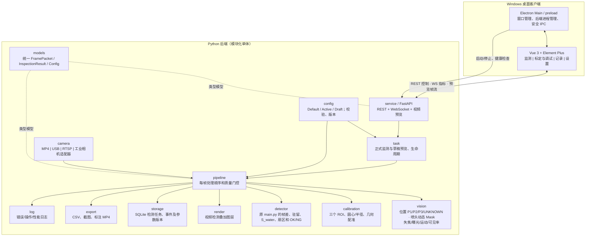
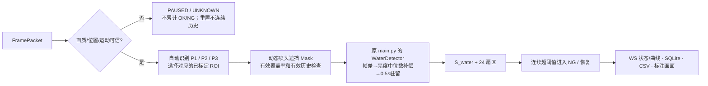

# 晶圆洗片视觉检测系统｜总体架构（V1）

> 项目：Windows 10/11 · Vue 3 + Electron + Element Plus 前端 · Python 后端  
> 原则：前端只展示与交互；Python 是视频源、ROI、帧差、S_water、状态判断及导出的唯一计算来源。

## 系统架构图



## 单帧执行顺序



## 目录规划

```text
water_detector/
├── frontend/                  # Vue 3 + TypeScript + Element Plus
│   └── src/
│       ├── api/               # REST/WS 客户端
│       ├── views/             # Monitor / Debug / Records / Settings
│       ├── components/        # VideoOverlay / ROIDragHandle / SWaterChart
│       ├── stores/            # Pinia
│       └── types/
├── electron/                  # 主进程、安全 preload、Python 进程守护
├── backend/
│   ├── src/water_detector/
│   │   ├── service/           # FastAPI & WebSocket
│   │   ├── camera/            # 视频源与帧时间戳
│   │   ├── pipeline/          # 逐帧调度/质量门控
│   │   ├── detector/          # main.py 算法等价迁移
│   │   ├── vision/            # 工位、喷头、清晰度、曝光
│   │   ├── calibration/       # 三个可编辑 ROI
│   │   ├── config/            # 参数与版本
│   │   ├── task/              # 监测任务与独立调试任务
│   │   ├── models/            # 数据契约
│   │   ├── render/            # 叠加帧、诊断视图
│   │   ├── storage/           # SQLite
│   │   ├── export/            # MP4 / CSV / 截图
│   │   ├── log/               # 结构化日志
│   │   └── integration/       # 未来 PLC / MES 扩展
│   └── tests/                 # 单元、接口与回归
├── docs/                      # 架构、协议、算法与实施记录
├── samples/                   # .gitignore 忽略大体积视频/本地数据
└── scripts/
```

## 重要设计约束

1. **保持原始判定**：迁移 `main.py` 的圆心/半径标定、`0.65R～0.95R`、`diff_threshold=8`、`history_seconds=0.5`、`persistence_threshold=0.5`、`S_water_threshold=0.010`、`ng_hold_seconds=0.5`、`recover_seconds=0.3`、24 扇区。额外特性必须默认关闭或有明确配置版本；通过 good/bad 视频逐帧回归。
2. **三工位不按时间硬切**：每帧从视觉结构识别 P1/P2/P3/UNKNOWN，未知时暂停；每工位单独标定并保存。
3. **动态喷头**：运行时检测喷头 Mask，不要求用户画固定喷头排除区域；提供检测框与 Mask 调试显示。第一版允许识别不足时拒绝判断，禁止把缺失的 Mask 当作可靠无遮挡。
4. **画质门控**：模糊、曝光不可信、位置移动、ROI 覆盖率不足时输出 PAUSED/UNKNOWN/INVALID，不宣称 OK；恢复后清空不连续历史。
5. **前端不做检测运算**：画面内拖动中心与半径只产生标定草稿；后端计算新 ROI 与 `S_water history` 并推送预览。
6. **正式与预览隔离**：Active 配置供正式监测；Draft 配置供独立预览；确认保存后才生成新版 Active。
7. **时间戳真实可靠**：MP4 用源视频时间；实时源用采集单调时间；帧间隔异常不沿用旧的连续异常时长。
8. **结果可追溯**：任务、相机标识、工位、配置版本、ROI 版本、帧时间、S_water、判定和异常证据可追踪。

## 计划实现阶段

- **阶段 1**：搭建 Electron/Vue 与 FastAPI 基础链路，MP4 预览，开始/停止，WebSocket 指标。
- **阶段 2**：原 `main.py` 算法等价迁移与 good/bad 回归，`S_water history` 曲线。
- **阶段 3**：P1/P2/P3 标定界面（拖拽圆心/半径）、草稿参数预览与提交。
- **阶段 4**：位置自动识别、喷头动态 Mask、失焦/曝光及覆盖率门控。
- **阶段 5**：USB/RTSP/工业相机适配器、CSV/截图/视频、SQLite 与 Windows 打包。

本文件是架构设计基准；未验证的工位自动识别/移动喷头准确率不能用作量产承诺。
